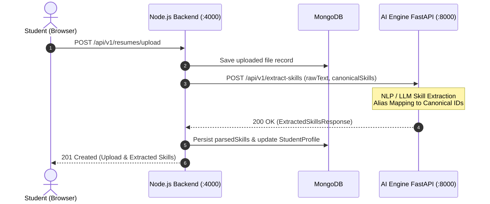

# Backend-to-AI Service Contract Specification — CareerPulse

> Official specification for internal HTTP communication between the Node.js Backend and the Python FastAPI AI Engine.
> **Security Requirement**: The frontend must NEVER call the AI service directly. All AI workloads are mediated by the backend.

---

## 1. Architectural Principles & Communication Protocol



### Protocol Standards
- **Transport**: HTTP/1.1 REST over private internal network.
- **Base URL**: `http://localhost:8000` (Docker: `http://ai-engine:8000`).
- **Service Authentication**: Header `X-Service-Auth: <INTERNAL_AI_SECRET>`.
- **Stateless Execution**: The AI Engine does not own a database connection. All required context (student profile, target role benchmarks, available skills catalog) is supplied in the request body.
- **Serialization**: JSON using Python Pydantic v2 schemas.

---

## 2. Service Endpoints Specification

### 2.1 Skill Extraction from Text (`POST /api/v1/extract-skills`)
Extracts technical and soft skills from parsed resume text, normalizing each match to the canonical skill catalog.

#### Request Schema
```json
{
  "rawText": "Experienced UI/UX designer with 3 years using Figma, Auto Layout, component variants, and HTML/CSS. Led user research interviews and developed design systems.",
  "knownTaxonomySlugs": [
    "skill_design_figma",
    "skill_design_ui_ux",
    "skill_design_user_research",
    "skill_fe_html_css",
    "skill_fe_react"
  ]
}
```

#### Response Schema (`HTTP 200 OK`)
```json
{
  "success": true,
  "service": "careerpulse-ai-engine",
  "extractedSkills": [
    {
      "canonicalId": "skill_design_figma",
      "matchedText": "Figma, Auto Layout",
      "confidence": 0.95,
      "estimatedLevel": 75,
      "contextSnippet": "...using Figma, Auto Layout, component variants..."
    },
    {
      "canonicalId": "skill_design_user_research",
      "matchedText": "user research interviews",
      "confidence": 0.88,
      "estimatedLevel": 60,
      "contextSnippet": "...Led user research interviews and developed..."
    },
    {
      "canonicalId": "skill_fe_html_css",
      "matchedText": "HTML/CSS",
      "confidence": 0.82,
      "estimatedLevel": 65,
      "contextSnippet": "...and HTML/CSS. Led user research..."
    }
  ],
  "unmappedTokens": ["component variants", "design systems"],
  "modelUsed": "taxonomy_regex_ner_v1"
}
```

---

### 2.2 Skill Gap Analysis (`POST /api/v1/skill-gap`)
Analyzes a student's current skills against a target role's benchmarks, computing readiness scores and prioritized gap insights.

#### Request Schema
```json
{
  "studentSkills": [
    { "canonicalId": "skill_design_figma", "level": 79 },
    { "canonicalId": "skill_design_ui_ux", "level": 88 },
    { "canonicalId": "skill_design_user_research", "level": 54 },
    { "canonicalId": "skill_fe_html_css", "level": 68 }
  ],
  "roleRequirements": [
    { "canonicalSkillId": "skill_design_figma", "skillName": "Figma", "requiredLevel": 85, "weight": 0.25 },
    { "canonicalSkillId": "skill_design_ui_ux", "skillName": "UI/UX Design", "requiredLevel": 85, "weight": 0.25 },
    { "canonicalSkillId": "skill_design_user_research", "skillName": "User Research", "requiredLevel": 80, "weight": 0.20 },
    { "canonicalSkillId": "skill_design_prototyping", "skillName": "Prototyping", "requiredLevel": 85, "weight": 0.15 },
    { "canonicalSkillId": "skill_fe_html_css", "skillName": "HTML/CSS", "requiredLevel": 75, "weight": 0.10 },
    { "canonicalSkillId": "skill_soft_communication", "skillName": "Communication", "requiredLevel": 80, "weight": 0.05 }
  ]
}
```

#### Response Schema (`HTTP 200 OK`)
```json
{
  "success": true,
  "careerReadinessScore": 72,
  "gaps": [
    {
      "canonicalSkillId": "skill_design_prototyping",
      "skillName": "Prototyping",
      "currentLevel": 0,
      "requiredLevel": 85,
      "gap": 85,
      "severity": "major_gap",
      "priority": 1,
      "insight": "Missing completely. Prototyping is essential for high-fidelity interactive user testing."
    },
    {
      "canonicalSkillId": "skill_design_user_research",
      "skillName": "User Research",
      "currentLevel": 54,
      "requiredLevel": 80,
      "gap": 26,
      "severity": "gap",
      "priority": 2,
      "insight": "Major gap (54% vs 80% required). Focus on user interviews and usability testing workflows."
    },
    {
      "canonicalSkillId": "skill_design_figma",
      "skillName": "Figma",
      "currentLevel": 79,
      "requiredLevel": 85,
      "gap": 6,
      "severity": "small_gap",
      "priority": 3,
      "insight": "Close to target (79% vs 85%). Advanced Auto Layout mastery will close this gap."
    }
  ]
}
```

---

### 2.3 Career Role Matching (`POST /api/v1/career-match`)
Calculates fit scores for a student across all active career roles in the platform.

#### Request Schema
```json
{
  "studentSkills": [
    { "canonicalId": "skill_design_figma", "level": 79 },
    { "canonicalId": "skill_design_ui_ux", "level": 88 },
    { "canonicalId": "skill_fe_html_css", "level": 68 }
  ],
  "candidateRoles": [
    {
      "canonicalId": "role_ui_ux_designer",
      "title": "UI/UX Designer",
      "requirements": [
        { "canonicalSkillId": "skill_design_figma", "requiredLevel": 85, "weight": 0.4 },
        { "canonicalSkillId": "skill_design_ui_ux", "requiredLevel": 85, "weight": 0.4 },
        { "canonicalSkillId": "skill_fe_html_css", "requiredLevel": 75, "weight": 0.2 }
      ]
    },
    {
      "canonicalId": "role_frontend_dev",
      "title": "Frontend Developer",
      "requirements": [
        { "canonicalSkillId": "skill_fe_html_css", "requiredLevel": 85, "weight": 0.3 },
        { "canonicalSkillId": "skill_fe_react", "requiredLevel": 80, "weight": 0.4 },
        { "canonicalSkillId": "skill_fe_javascript", "requiredLevel": 85, "weight": 0.3 }
      ]
    }
  ]
}
```

#### Response Schema (`HTTP 200 OK`)
```json
{
  "success": true,
  "matches": [
    {
      "canonicalRoleId": "role_ui_ux_designer",
      "fitScore": 84,
      "rank": 1,
      "strengths": ["skill_design_ui_ux", "skill_design_figma"],
      "primaryGaps": ["skill_fe_html_css"]
    },
    {
      "canonicalRoleId": "role_frontend_dev",
      "fitScore": 24,
      "rank": 2,
      "strengths": ["skill_fe_html_css"],
      "primaryGaps": ["skill_fe_react", "skill_fe_javascript"]
    }
  ]
}
```

---

### 2.4 Roadmap Milestone Generation (`POST /api/v1/generate-roadmap`)
Sequences milestone modules based on student's weekly study hours and priority gaps.

#### Request Schema
```json
{
  "targetRoleId": "role_ui_ux_designer",
  "weeklyLearningHours": 10,
  "skillGaps": [
    { "canonicalSkillId": "skill_design_prototyping", "gap": 85, "priority": 1 },
    { "canonicalSkillId": "skill_design_user_research", "gap": 26, "priority": 2 },
    { "canonicalSkillId": "skill_design_figma", "gap": 6, "priority": 3 }
  ]
}
```

#### Response Schema (`HTTP 200 OK`)
```json
{
  "success": true,
  "estimatedTotalHours": 46,
  "estimatedWeeks": 5,
  "milestones": [
    {
      "milestoneId": "ms_01",
      "orderIndex": 1,
      "title": "Advanced Auto Layout & Design Systems in Figma",
      "targetSkillId": "skill_design_figma",
      "targetGain": 10,
      "estimatedHours": 12,
      "pedagogicalGoal": "Close immediate small gap to achieve job-ready Figma benchmark."
    },
    {
      "milestoneId": "ms_02",
      "orderIndex": 2,
      "title": "UX Research Methods: Interviews & Usability Testing",
      "targetSkillId": "skill_design_user_research",
      "targetGain": 25,
      "estimatedHours": 18,
      "pedagogicalGoal": "Address primary major gap in qualitative research methods."
    },
    {
      "milestoneId": "ms_03",
      "orderIndex": 3,
      "title": "High-Fidelity Prototyping & Micro-Interactions",
      "targetSkillId": "skill_design_prototyping",
      "targetGain": 50,
      "estimatedHours": 16,
      "pedagogicalGoal": "Build foundational prototyping capabilities for design review."
    }
  ]
}
```

---

## 3. Resilience, Timeout & Fallback Policies

| Scenario | Timeout | Retry Policy | Fallback Behavior |
|---|---|---|---|
| **Deterministic Algorithms** (`skill-gap`, `career-match`) | 3000 ms | 1 retry | Evaluated via pure backend mathematical formula if AI service is offline. |
| **NER / Rule Skill Extraction** | 5000 ms | 1 retry | Direct regex dictionary matching against known canonical aliases. |
| **LLM Reasoning Pipelines** (`generate-roadmap`) | 12000 ms | 2 retries | Template-driven milestone sequencing based on gap severity and predefined milestones. |

### Degraded Mode Envelope
When a fallback heuristic is executed due to AI service timeout, the response flags degraded status:
```json
{
  "success": true,
  "degradedMode": true,
  "fallbackUsed": "template_heuristic_sequencer",
  "data": { "..." }
}
```
