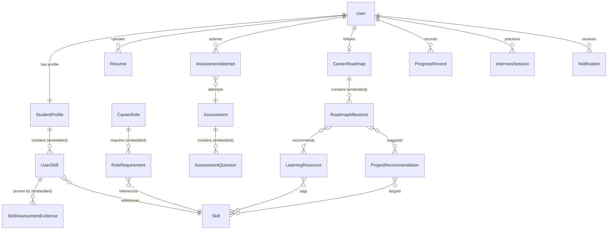

# Database Design & Schema Specification — CareerPulse

> Official specification for MongoDB database collections, embedded schemas, relationships, indexing, and data retention rules.

---

## 1. Architectural Strategy & Entity Model

CareerPulse uses **MongoDB** as its primary persistent datastore. Data modeling adheres to the following rules:
- **Independent Querying**: Core business aggregates (`User`, `StudentProfile`, `Skill`, `CareerRole`, `Resume`, `Assessment`, `AssessmentAttempt`, `CareerRoadmap`, `LearningResource`, `ProgressRecord`, `InterviewSession`, `ProjectRecommendation`, `Notification`) live in their own collections.
- **Embedded Subdocuments**: Highly coupled child entities with bounded growth (`RoleRequirement`, `RoadmapMilestone`, `UserSkill`, `SkillAssessmentEvidence`, `AssessmentQuestion`) are embedded directly within their parent document to ensure atomic operations and avoid expensive cross-collection joins.
- **Referential Integrity**: ObjectIds are validated in Mongoose middleware; soft-deletions and cascade deletions clean up dependent resources when a student deletes their account.

---

## 2. Entity Relationship Diagram (ERD)



---

## 3. Detailed Entity Specifications

### 3.1 `User` (Collection: `users`)
The central authentication entity for students and administrators.

| Field | Type | Required | Default | Indexes | Description / Validation |
|---|---|---|---|---|---|
| `_id` | `ObjectId` | Yes | Auto | PK | Unique MongoDB document identifier |
| `email` | `String` | Yes | — | `unique` | Lowercase, valid email regex format (`/^[^\s@]+@[^\s@]+\.[^\s@]+$/`) |
| `passwordHash` | `String` | Yes | — | — | bcrypt hash (12 salt rounds), excluded by default in queries |
| `name` | `String` | Yes | — | — | Full name, length 2–80 chars |
| `role` | `String` | Yes | `'student'` | — | Enum: `['student', 'admin']` |
| `isEmailVerified` | `Boolean`| Yes | `false` | — | Verification status flag |
| `lastLoginAt` | `Date` | No | `null` | — | Timestamp of most recent successful session |
| `createdAt` | `Date` | Yes | Auto | — | Timestamp when user registered |
| `updatedAt` | `Date` | Yes | Auto | — | Timestamp of last modification |

- **Lifecycle & Ownership**: Root entity. Deleting a User triggers cascading deletion of their Profile, Resumes, Roadmaps, and Progress records.

---

### 3.2 `StudentProfile` (Collection: `student_profiles`)
Contains academic details, career objectives, and live skill proficiencies.

| Field | Type | Required | Default | Indexes | Description / Validation |
|---|---|---|---|---|---|
| `_id` | `ObjectId` | Yes | Auto | PK | Document identifier |
| `userId` | `ObjectId` | Yes | — | `unique` | Ref: `User._id` (1-to-1 relationship) |
| `degree` | `String` | Yes | — | — | Academic qualification (e.g. `B.Tech`, `B.Sc`, `BCA`) |
| `branch` | `String` | Yes | — | — | Field of study (e.g. `Computer Science`, `IT`, `Design`) |
| `year` | `Number` | Yes | `1` | — | Integer `1` to `5` |
| `cgpa` | `Number` | No | `null` | — | Range `0.0` to `10.0` |
| `bio` | `String` | No | `""` | — | Short student bio (max 500 chars) |
| `targetRoleId` | `String` | No | `null` | — | Canonical role ID (e.g., `role_ui_ux_designer`) |
| `weeklyLearningHours`| `Number`| Yes | `10` | — | Integer between `1` and `60` |
| `skills` | `UserSkill[]` | Yes | `[]` | — | Embedded array of current student skills |
| `createdAt` | `Date` | Yes | Auto | — | Profile creation timestamp |
| `updatedAt` | `Date` | Yes | Auto | — | Last update timestamp |

---

### 3.3 `UserSkill` (Embedded Subdocument in `StudentProfile`)
Tracks the current proficiency and evidence of a student's individual skill.

| Field | Type | Required | Default | Description / Validation |
|---|---|---|---|---|
| `canonicalId` | `String` | Yes | — | Canonical skill slug (e.g., `skill_design_figma`) |
| `name` | `String` | Yes | — | Human-readable name (e.g., `Figma`) |
| `category` | `String` | Yes | — | Category key (e.g., `design_ux`) |
| `level` | `Number` | Yes | `0` | Standardized proficiency level `0` to `100` |
| `tier` | `String` | Yes | `'beginner'`| Computed enum: `['beginner', 'developing', 'proficient', 'advanced']` |
| `lastAssessedAt` | `Date` | No | `null` | Timestamp of latest assessment or update |
| `evidence` | `SkillAssessmentEvidence[]` | Yes | `[]` | Embedded audit trail of evidence |

---

### 3.4 `SkillAssessmentEvidence` (Embedded Subdocument in `UserSkill`)
Audit trail record supporting how a student acquired or verified a skill level.

| Field | Type | Required | Default | Description / Validation |
|---|---|---|---|---|
| `source` | `String` | Yes | — | Enum: `['self_report', 'resume_extracted', 'quiz_assessment', 'project_evaluated', 'course_completed']` |
| `sourceId` | `String` | No | `null` | Reference ID to assessment attempt, resume, or project |
| `score` | `Number` | Yes | — | Score or confidence contributed (0–100) |
| `verifiedStatus` | `String` | Yes | `'unverified'` | Enum: `['unverified', 'pending_verification', 'verified', 'disputed']` |
| `recordedAt` | `Date` | Yes | `Date.now` | Timestamp when evidence was logged |

---

### 3.5 `Skill` (Collection: `skills` — Master Taxonomy)
Platform-wide canonical catalog of all tracked capabilities.

| Field | Type | Required | Default | Indexes | Description / Validation |
|---|---|---|---|---|---|
| `_id` | `ObjectId` | Yes | Auto | PK | Primary key |
| `canonicalId` | `String` | Yes | — | `unique` | Canonical slug identifier (e.g., `skill_fe_react`) |
| `name` | `String` | Yes | — | `unique` | Display name (e.g., `React`) |
| `category` | `String` | Yes | — | `index` | Enum: `['design_ux', 'frontend', 'backend', 'data_ai', 'cloud_devops', 'soft_skills']` |
| `description` | `String` | No | `""` | — | Detailed summary of the skill |
| `aliases` | `String[]` | Yes | `[]` | `multikey` | Known synonyms for parsing (e.g., `['React.js', 'ReactJS']`) |
| `tags` | `String[]` | Yes | `[]` | — | Taxonomy search tags |
| `isDeprecated` | `Boolean`| Yes | `false` | — | Deprecation flag |
| `createdAt` | `Date` | Yes | Auto | — | Creation timestamp |

---

### 3.6 `CareerRole` (Collection: `career_roles`)
Standard industry roles and their competency baselines.

| Field | Type | Required | Default | Indexes | Description / Validation |
|---|---|---|---|---|---|
| `_id` | `ObjectId` | Yes | Auto | PK | Primary key |
| `canonicalId` | `String` | Yes | — | `unique` | Canonical role slug (e.g., `role_ui_ux_designer`) |
| `title` | `String` | Yes | — | `unique` | Official job title (e.g., `UI/UX Designer`) |
| `description` | `String` | Yes | — | — | Role scope and responsibilities summary |
| `department` | `String` | Yes | — | — | Category (e.g. `Design`, `Engineering`, `Data`) |
| `demandLevel` | `String` | Yes | `'medium'`| — | Enum: `['low', 'medium', 'high']` |
| `averageSalary`| `String` | No | `null` | — | Market salary range (e.g. `$70k - $95k`) |
| `requiredSkills`| `RoleRequirement[]`| Yes| `[]` | — | Embedded skill benchmarks |
| `isPublished` | `Boolean`| Yes | `true` | — | Student visibility flag |
| `createdAt` | `Date` | Yes | Auto | — | Timestamp |

---

### 3.7 `RoleRequirement` (Embedded Subdocument in `CareerRole`)
The benchmark requirement for a specific skill within a career role.

| Field | Type | Required | Default | Description / Validation |
|---|---|---|---|---|
| `canonicalSkillId`| `String` | Yes | — | Ref: `Skill.canonicalId` |
| `skillName` | `String` | Yes | — | Display name for quick access without join |
| `requiredLevel` | `Number` | Yes | `75` | Required proficiency baseline (0–100) |
| `weight` | `Number` | Yes | `1.0` | Importance weighting factor ($w_i \ge 0$) |
| `isMandatory` | `Boolean`| Yes | `true` | Hard requirement vs nice-to-have |

---

### 3.8 `Resume` (Collection: `resumes`)
Uploaded student resumes, extraction statuses, and parsed JSON skill records.

| Field | Type | Required | Default | Indexes | Description / Validation |
|---|---|---|---|---|---|
| `_id` | `ObjectId` | Yes | Auto | PK | Primary key |
| `userId` | `ObjectId` | Yes | — | `index` | Ref: `User._id` |
| `fileName` | `String` | Yes | — | — | Original file name (e.g. `resume_arjun.pdf`) |
| `storageKey` | `String` | Yes | — | — | Internal storage path / S3 key |
| `fileSize` | `Number` | Yes | — | — | Size in bytes (max 10MB) |
| `mimeType` | `String` | Yes | — | — | Allowed: `application/pdf`, `application/vnd.openxmlformats-officedocument.wordprocessingml.document` |
| `parseStatus` | `String` | Yes | `'pending'`| — | Enum: `['pending', 'processing', 'completed', 'failed']` |
| `parsedSkills` | `Array` | Yes | `[]` | — | Array of `{ canonicalId, name, rawText, confidence }` |
| `errorMessage` | `String` | No | `null` | — | Failure reason if parsing failed |
| `uploadedAt` | `Date` | Yes | Auto | — | Upload timestamp |

- **Lifecycle & Retention**: Stored files are immediately purged from disk/S3 if the student deletes the resume or their account.

---

### 3.9 `Assessment` (Collection: `assessments`)
Predefined skill evaluation quizzes and rubrics.

| Field | Type | Required | Default | Indexes | Description / Validation |
|---|---|---|---|---|---|
| `_id` | `ObjectId` | Yes | Auto | PK | Primary key |
| `title` | `String` | Yes | — | — | Assessment title (e.g., `Figma Essentials Quiz`) |
| `description` | `String` | Yes | — | — | Assessment guidelines and instructions |
| `category` | `String` | Yes | — | `index` | Enum matching skill categories |
| `targetSkillIds`| `String[]`| Yes | `[]` | — | Array of canonical skill slugs tested |
| `timeLimitMinutes`| `Number`| Yes | `20` | — | Time limit for completion |
| `questions` | `AssessmentQuestion[]`| Yes | `[]`| — | Embedded question bank |
| `isActive` | `Boolean`| Yes | `true` | — | Availability flag |
| `createdAt` | `Date` | Yes | Auto | — | Creation timestamp |

---

### 3.10 `AssessmentQuestion` (Embedded Subdocument in `Assessment`)
A single test item within an assessment.

| Field | Type | Required | Default | Description / Validation |
|---|---|---|---|---|
| `questionId` | `String` | Yes | Auto | Unique question identifier |
| `text` | `String` | Yes | — | The question prompt text |
| `type` | `String` | Yes | `'multiple_choice'` | Enum: `['multiple_choice', 'scale', 'code_snippet']` |
| `options` | `String[]` | Yes | — | Array of selectable answers (minimum 2) |
| `correctOptionIndex` | `Number` | Yes | — | 0-based index of correct option (never sent to client during test) |
| `testedSkillId`| `String` | Yes | — | Associated canonical skill slug |
| `difficultyLevel` | `Number` | Yes | `50` | Scale 1–100 representing question difficulty |

---

### 3.11 `AssessmentAttempt` (Collection: `assessment_attempts`)
A student's completed or submitted evaluation attempt.

| Field | Type | Required | Default | Indexes | Description / Validation |
|---|---|---|---|---|---|
| `_id` | `ObjectId` | Yes | Auto | PK | Primary key |
| `userId` | `ObjectId` | Yes | — | `index` | Ref: `User._id` |
| `assessmentId` | `ObjectId` | Yes | — | `index` | Ref: `Assessment._id` |
| `answers` | `Map` | Yes | `{}` | — | Key-value map of `{ questionId: selectedIndex }` |
| `totalScore` | `Number` | Yes | `0` | — | Overall percentage score (0–100) |
| `skillScores` | `Map` | Yes | `{}` | — | Map of `{ canonicalSkillId: achievedLevel }` |
| `timeTakenSeconds`| `Number`| Yes | `0` | — | Total duration elapsed |
| `completedAt` | `Date` | Yes | Auto | `index` | Submission timestamp |

- **Compound Index**: `{ userId: 1, assessmentId: 1, completedAt: -1 }` for querying recent attempts.

---

### 3.12 `CareerRoadmap` (Collection: `career_roadmaps`)
Personalized milestone-driven learning plan generated for a student.

| Field | Type | Required | Default | Indexes | Description / Validation |
|---|---|---|---|---|---|
| `_id` | `ObjectId` | Yes | Auto | PK | Primary key |
| `userId` | `ObjectId` | Yes | — | `unique` | Ref: `User._id` (one active roadmap per user) |
| `targetRoleId` | `String` | Yes | — | — | Canonical role slug (e.g. `role_ui_ux_designer`) |
| `status` | `String` | Yes | `'active'`| `index` | Enum: `['draft', 'active', 'paused', 'completed', 'archived']` |
| `weeklyHours` | `Number` | Yes | `10` | — | Pacing commitment |
| `estimatedTotalHours`| `Number`| Yes | `60` | — | Sum of all milestone durations |
| `milestones` | `RoadmapMilestone[]` | Yes | `[]` | — | Ordered sequence of learning milestones |
| `generatedAt` | `Date` | Yes | Auto | — | Initial generation timestamp |
| `updatedAt` | `Date` | Yes | Auto | — | Last modification timestamp |

---

### 3.13 `RoadmapMilestone` (Embedded Subdocument in `CareerRoadmap`)
A concrete learning phase addressing specific skill gaps.

| Field | Type | Required | Default | Description / Validation |
|---|---|---|---|---|
| `milestoneId` | `String` | Yes | Auto | Stable UUID / slug identifier |
| `orderIndex` | `Number` | Yes | `0` | Sequence ordering integer |
| `title` | `String` | Yes | — | e.g., `Mastering Auto Layout & Components` |
| `targetSkillId`| `String` | Yes | — | Canonical skill slug |
| `targetGain` | `Number` | Yes | `15` | Target proficiency point increase |
| `estimatedHours` | `Number` | Yes | `12` | Estimated hours to complete |
| `status` | `String` | Yes | `'locked'` | Enum: `['locked', 'available', 'in_progress', 'completed', 'skipped']` |
| `resourceIds` | `ObjectId[]` | Yes | `[]` | References to recommended `LearningResource` items |
| `projectRecommendationId` | `ObjectId` | No | `null` | Optional hands-on capstone reference |
| `completedAt` | `Date` | No | `null` | Timestamp when marked completed |

---

### 3.14 `LearningResource` (Collection: `learning_resources`)
Curated courses, tutorials, videos, and articles mapped to skills.

| Field | Type | Required | Default | Indexes | Description / Validation |
|---|---|---|---|---|---|
| `_id` | `ObjectId` | Yes | Auto | PK | Primary key |
| `title` | `String` | Yes | — | `text` | Resource title |
| `provider` | `String` | Yes | — | — | e.g., `Coursera`, `YouTube`, `Figma Community`, `freeCodeCamp` |
| `url` | `String` | Yes | — | — | Valid external HTTPS link |
| `type` | `String` | Yes | `'course'`| — | Enum: `['course', 'video', 'article', 'project', 'book']` |
| `targetSkillIds`| `String[]`| Yes | `[]` | `multikey` | Canonical skill slugs addressed |
| `targetLevelMin`| `Number` | Yes | `0` | — | Minimum student level appropriate (0–100) |
| `targetLevelMax`| `Number` | Yes | `100` | — | Maximum student level appropriate (0–100) |
| `durationHours`| `Number` | No | `null` | — | Estimated hours to consume |
| `isFree` | `Boolean` | Yes | `true` | — | Whether free or requires payment |
| `rating` | `Number` | No | `4.8` | — | Rating score (1.0 to 5.0) |
| `isVerified` | `Boolean` | Yes | `true` | — | Admin verification status |

---

### 3.15 `ProgressRecord` (Collection: `progress_records`)
Granular activity logs tracking daily/weekly learning study hours and events.

| Field | Type | Required | Default | Indexes | Description / Validation |
|---|---|---|---|---|---|
| `_id` | `ObjectId` | Yes | Auto | PK | Primary key |
| `userId` | `ObjectId` | Yes | — | `index` | Ref: `User._id` |
| `milestoneId` | `String` | No | `null` | — | Associated milestone identifier |
| `activityType`| `String` | Yes | `'study_session'` | — | Enum: `['study_session', 'course_completed', 'quiz_completed', 'project_submitted']` |
| `hoursSpent` | `Number` | Yes | `1.0` | — | Time logged (min 0.1, max 24.0) |
| `notes` | `String` | No | `""` | — | Optional reflection notes |
| `date` | `Date` | Yes | `Date.now` | `index` | Date of the learning session |

- **Compound Index**: `{ userId: 1, date: -1 }` for generating learning activity charts and streaks.

---

### 3.16 `InterviewSession` (Collection: `interview_sessions`)
Mock interview and AI practice conversations.

| Field | Type | Required | Default | Indexes | Description / Validation |
|---|---|---|---|---|---|
| `_id` | `ObjectId` | Yes | Auto | PK | Primary key |
| `userId` | `ObjectId` | Yes | — | `index` | Ref: `User._id` |
| `targetRoleId` | `String` | Yes | — | — | Canonical role identifier |
| `status` | `String` | Yes | `'in_progress'` | — | Enum: `['in_progress', 'completed', 'abandoned']` |
| `overallFeedback`| `String`| No | `null` | — | AI synthesis feedback |
| `overallScore` | `Number` | No | `null` | — | Evaluation score (0–100) |
| `messages` | `Array` | Yes | `[]` | — | Array of `{ sender: 'ai'|'user', text, timestamp }` |
| `createdAt` | `Date` | Yes | Auto | — | Session start timestamp |

---

### 3.17 `ProjectRecommendation` (Collection: `project_recommendations`)
Practical portfolio projects suggested to students to build concrete skill proof.

| Field | Type | Required | Default | Indexes | Description / Validation |
|---|---|---|---|---|---|
| `_id` | `ObjectId` | Yes | Auto | PK | Primary key |
| `title` | `String` | Yes | — | — | Project title (e.g., `Fintech Design System`) |
| `description` | `String` | Yes | — | — | Objective, user problem, and deliverable guidelines |
| `difficulty` | `String` | Yes | `'intermediate'`| — | Enum: `['beginner', 'intermediate', 'advanced']` |
| `targetSkillIds`| `String[]`| Yes | `[]` | `multikey` | Canonical skill slugs verified by project |
| `estimatedHours`| `Number`| Yes | `20` | — | Estimated hours to complete |
| `deliverableType`| `String`| Yes | `'figma_prototype'` | — | Enum: `['figma_prototype', 'github_repo', 'case_study', 'live_deployment']` |

---

### 3.18 `Notification` (Collection: `notifications`)
In-app alerts and reminders for students.

| Field | Type | Required | Default | Indexes | Description / Validation |
|---|---|---|---|---|---|
| `_id` | `ObjectId` | Yes | Auto | PK | Primary key |
| `userId` | `ObjectId` | Yes | — | `index` | Ref: `User._id` |
| `title` | `String` | Yes | — | — | Short alert header |
| `message` | `String` | Yes | — | — | Notification body content |
| `type` | `String` | Yes | `'info'` | — | Enum: `['info', 'roadmap_update', 'assessment_result', 'streak_reminder']` |
| `isRead` | `Boolean` | Yes | `false` | `index` | Read status |
| `actionUrl` | `String` | No | `null` | — | Deep link URL |
| `createdAt` | `Date` | Yes | Auto | `TTL` | Auto-purged after 30 days (`expireAfterSeconds: 2592000`) |

---

## 4. Database Indexing Strategy

```javascript
// users
db.users.createIndex({ email: 1 }, { unique: true });

// student_profiles
db.student_profiles.createIndex({ userId: 1 }, { unique: true });
db.student_profiles.createIndex({ "skills.canonicalId": 1 });

// skills
db.skills.createIndex({ canonicalId: 1 }, { unique: true });
db.skills.createIndex({ name: 1 }, { unique: true });
db.skills.createIndex({ category: 1 });
db.skills.createIndex({ aliases: 1 });

// career_roles
db.career_roles.createIndex({ canonicalId: 1 }, { unique: true });
db.career_roles.createIndex({ title: 1 }, { unique: true });

// resumes
db.resumes.createIndex({ userId: 1, uploadedAt: -1 });

// assessments & attempts
db.assessments.createIndex({ category: 1, isActive: 1 });
db.assessment_attempts.createIndex({ userId: 1, completedAt: -1 });
db.assessment_attempts.createIndex({ userId: 1, assessmentId: 1, completedAt: -1 });

// career_roadmaps
db.career_roadmaps.createIndex({ userId: 1 }, { unique: true });
db.career_roadmaps.createIndex({ status: 1 });

// learning_resources
db.learning_resources.createIndex({ targetSkillIds: 1 });
db.learning_resources.createIndex({ title: "text", provider: "text" });

// progress_records
db.progress_records.createIndex({ userId: 1, date: -1 });

// notifications
db.notifications.createIndex({ userId: 1, isRead: 1 });
db.notifications.createIndex({ createdAt: 1 }, { expireAfterSeconds: 2592000 }); // 30 day TTL
```

---

## 5. Data Privacy & Retention Policy

1. **Student Account Deletion (GDPR/Right to Be Forgotten)**:
   - When a student requests account deletion, all personal data in `users`, `student_profiles`, `resumes`, `career_roadmaps`, `progress_records`, `interview_sessions`, and `notifications` is immediately and permanently deleted.
   - Associated physical files stored on disk or S3 (`storageKey`) are deleted asynchronously via an event listener.
2. **Anonymized Research Retention**:
   - Assessment attempts and skill gap telemetry may only be retained if anonymized (all `userId` references permanently removed) for machine learning benchmark validation after explicit user opt-in.
