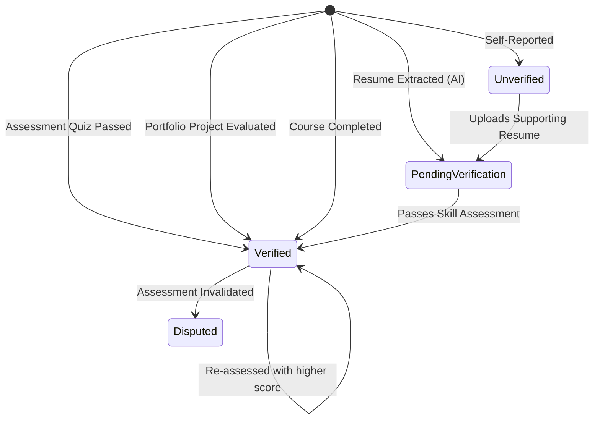
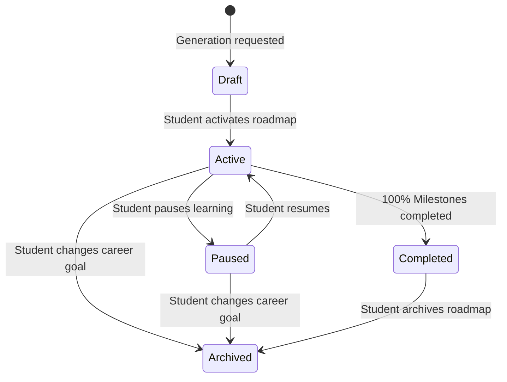
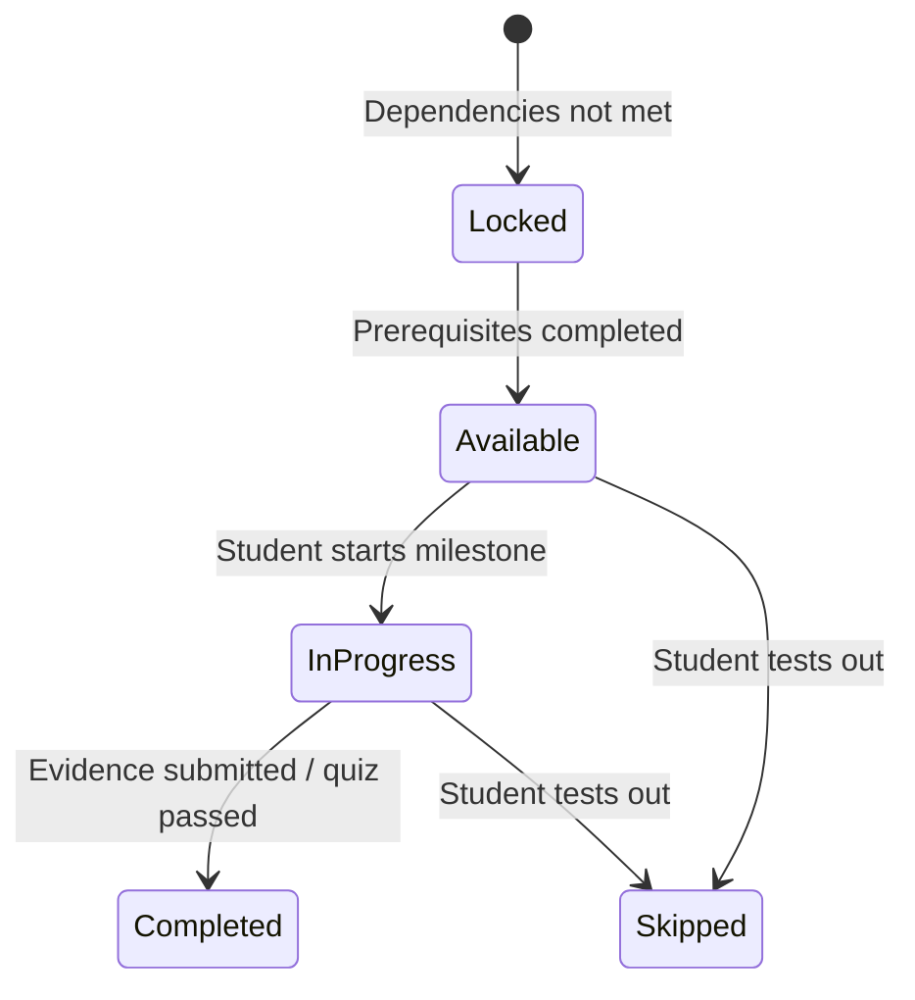

# Domain Model & Shared Specifications — CareerPulse

> Authoritative architectural specification for domain models, canonical identifiers, lifecycle state machines, and cross-cutting contracts in CareerPulse.

---

## 1. Architectural Principles

1. **Single Source of Truth**: Every business concept has exactly one authoritative representation.
2. **Canonical Identities**: Skills, career roles, and resources have immutable, canonical identifiers regardless of surface aliases or casing.
3. **Unified Measurement Scales**: All skill evaluations, gap calculations, and career readiness metrics use a single standardized 0–100 scale.
4. **Immutable History**: Historical events (assessment attempts, resume parsed versions, progress snapshots) are append-only to preserve learning trends.
5. **Strict Service Boundary**: The frontend communicates solely with the backend REST API (`/api/v1`). The AI Engine is an internal compute service invoked exclusively by the backend.

---

## 2. Canonical Skill System

### 2.1 Identifier & Normalization Standard
A skill must have exactly one canonical identity even when students, resumes, or external sources refer to it using varying syntax.

- **Canonical ID Format**: `skill_<domain>_<kebab-slug>` (e.g., `skill_design_figma`, `skill_prog_typescript`, `skill_prog_react`).
- **Canonical Name**: Title Case string (e.g., `TypeScript`, `UI/UX Design`, `React`).
- **Normalization Pipeline**:
  1. Trim whitespace, remove special unicode punctuation, and convert to lowercase.
  2. Query alias map (e.g., `react.js`, `reactjs`, `react 19` → `skill_prog_react`).
  3. If unmapped, compute standardized slug: `skill_general_<slug>`.

### 2.2 Skill Categories
Every skill belongs to one primary category and may have multi-dimensional search tags:

| Category Key | Category Display | Description | Sample Canonical Skills |
|---|---|---|---|
| `design_ux` | Design & UI/UX | Visual design, user research, wireframing, design systems | `skill_design_figma`, `skill_design_user_research` |
| `frontend` | Frontend Development | Web/client-side technologies, frameworks, build tools | `skill_fe_react`, `skill_fe_typescript`, `skill_fe_tailwind` |
| `backend` | Backend Development | Server-side runtimes, APIs, databases, microservices | `skill_be_nodejs`, `skill_be_express`, `skill_be_mongodb` |
| `data_ai` | Data & AI/ML | Data science, machine learning models, analytics, SQL | `skill_ai_python`, `skill_ai_machine_learning`, `skill_data_sql` |
| `cloud_devops`| Cloud & DevOps | CI/CD, containerization, cloud infrastructure | `skill_ops_docker`, `skill_ops_git`, `skill_ops_aws` |
| `soft_skills` | Professional & Soft Skills | Communication, problem solving, teamwork, leadership | `skill_soft_communication`, `skill_soft_problem_solving` |

---

## 3. Standardized Proficiency Scale & Readiness Metrics

### 3.1 The 0–100 Unified Scale
To prevent conflicting metrics between the frontend visualizations, backend gap analyzers, and AI scoring pipelines, all proficiency levels are expressed as an integer between **0 and 100**.

```
[0 ─────── 25] ─────── [26 ─────── 50] ─────── [51 ─────── 75] ─────── [76 ────── 100]
   Beginner              Developing             Proficient              Advanced
 (Foundational)         (Intermediate)          (Job-Ready)             (Mastery)
```

| Range | Tier Key | Display Label | Description & Capability Rubric |
|---|---|---|---|
| **0 – 25** | `beginner` | Beginner | Understands fundamental terminology and basic syntax; requires step-by-step guidance. |
| **26 – 50** | `developing` | Developing | Can build small, guided tasks or feature components; familiar with standard workflows. |
| **51 – 75** | `proficient` | Proficient (Job-Ready) | Independently implements end-to-end features, handles edge cases, and writes production code. |
| **76 – 100**| `advanced` | Advanced | Mastery level; understands architecture, performance optimization, best practices, and mentoring. |

### 3.2 Career Readiness Score Formula
The overall career readiness score ($R \in [0, 100]$) against a target `CareerRole` is computed as the weighted sum of skill satisfactions:

$$R = \sum_{i=1}^{N} w_i \times \min\left(1.0, \frac{\text{CurrentLevel}_i}{\text{RequiredLevel}_i}\right) \times 100$$

Where:
- $N$ is the number of required skills for the role.
- $w_i$ is the normalized weight of skill $i$ ($\sum w_i = 1.0$).
- If a skill requirement does not have an explicit weight, equal weighting ($w_i = \frac{1}{N}$) is applied.

### 3.3 Skill Gap Severity Classification
For a required skill with minimum required level $L_{\text{req}}$ and student level $L_{\text{curr}}$:

| Condition | Gap Category | Severity | Frontend Color / Badge |
|---|---|---|---|
| $L_{\text{curr}} \ge L_{\text{req}}$ | `met` | None | 🟢 Green (`Met / Strong`) |
| $0 < (L_{\text{req}} - L_{\text{curr}}) \le 15$ | `small_gap` | Low | 🟡 Amber (`Small Gap`) |
| $15 < (L_{\text{req}} - L_{\text{curr}}) \le 30$ | `gap` | Medium | 🟠 Orange (`Gap`) |
| $(L_{\text{req}} - L_{\text{curr}}) > 30$ | `major_gap` | High | 🔴 Red (`Major Gap`) |

---

## 4. Evidence Sources & Verification Lifecycle

Student skills evolve from multiple sources with varying degrees of confidence:



### 4.1 Evidence Sources
1. `self_report`: Student adjusted profile slider or self-selected skill on onboarding (Confidence: 0.4).
2. `resume_extracted`: AI Engine parsed skill from uploaded CV/resume with contextual frequency (Confidence: 0.7).
3. `quiz_assessment`: Scored MCQ assessment attempt via platform (Confidence: 0.9).
4. `project_evaluated`: Student submitted verifiable project code/portfolio link evaluated by rubric (Confidence: 0.95).
5. `course_completed`: Verified completion certificate from recommended resource (Confidence: 0.85).

---

## 5. Lifecycle State Machines

### 5.1 Career Roadmap Lifecycle


### 5.2 Roadmap Milestone Lifecycle


---

## 6. Global API Conventions

### 6.1 Uniform Response Envelope
All API endpoints return JSON following a strict contract:

#### Success Envelope (HTTP 200 / 201)
```json
{
  "success": true,
  "message": "Student profile updated successfully",
  "data": {
    "userId": "660c1f2e8f1b2c001a123456",
    "careerGoal": "UI/UX Designer",
    "readinessScore": 72
  },
  "meta": {
    "timestamp": "2026-10-14T00:45:00.000Z"
  }
}
```

#### Error Envelope (HTTP 4xx / 5xx)
```json
{
  "success": false,
  "message": "Validation failed",
  "errors": [
    {
      "field": "weeklyLearningHours",
      "message": "Weekly learning hours must be between 1 and 60"
    }
  ],
  "meta": {
    "timestamp": "2026-10-14T00:45:00.000Z"
  }
}
```

### 6.2 Standard Pagination Conventions
For all listing endpoints (`GET /api/v1/resources`, `GET /api/v1/career-roles`, etc.):

- **Query Parameters**:
  - `page`: 1-based page number (default: `1`, minimum: `1`).
  - `limit`: number of items per page (default: `20`, maximum: `100`).
  - `sort`: field to sort by with `-` prefix for descending (default: `-createdAt`).
  - `search`: optional substring search query.

- **Response `meta` Object**:
```json
{
  "data": [ "..." ],
  "meta": {
    "page": 1,
    "limit": 20,
    "total": 54,
    "totalPages": 3,
    "hasNext": true,
    "hasPrev": false
  }
}
```

### 6.3 Identifiers & Timestamp Conventions
- **Internal Database IDs**: 24-character hexadecimal MongoDB `ObjectId` string (serialized as `id` or `_id`).
- **Domain Canonical Slugs**: Lowercase alphanumeric string with underscores (e.g. `skill_design_figma`, `role_ui_ux_designer`).
- **Timestamps**: All timestamps must be ISO 8601 UTC strings (`YYYY-MM-DDTHH:mm:ss.sssZ`).

---

## 7. Ownership & Authorization Model

| Role | Permissions |
|---|---|
| **`student`** | - Read and update own User, StudentProfile, Resumes, and Roadmap.<br>- Submit AssessmentAttempts and record learning progress.<br>- Read-only access to published CareerRoles, Skills taxonomy, and LearningResources. |
| **`admin`** | - All student capabilities across all tenants.<br>- Full CRUD on Skills taxonomy, CareerRoles, RoleRequirements, and LearningResources.<br>- View anonymized platform analytics and metrics. |
| **`system`** | - Internal service-to-service communication (Backend ↔ AI Engine). |

> **Tenancy Rule**: A student cannot read or modify another student's profile, resume, assessment attempt, roadmap, or progress record. Any unauthorized attempt returns `HTTP 403 Forbidden`.
